# TF2 Player Check

(formerly [SteamTools](https://github.com/fooberticus/SteamTools))

[](https://github.com/fooberticus/TF2PlayerCheck/blob/main/LICENSE.txt)
[](https://github.com/fooberticus/TF2PlayerCheck/releases)

Easy-to-use tools for checking Team Fortress 2 (TF2) players for VAC and community server bans. Know who you're playing with!

With one click, TF2 Player Check reads the player list straight from your running game (or from pasted `status` console output)
and checks several different sources for player bans and other information, including:

* Steam VAC and Game bans from Valve
* Steam Community Server bans and other info from SteamHistory.net
* Rent-a-Medic cheater lists
* Backpack.tf TF2 inventory values
* Time on server, ping, Steam ID and more

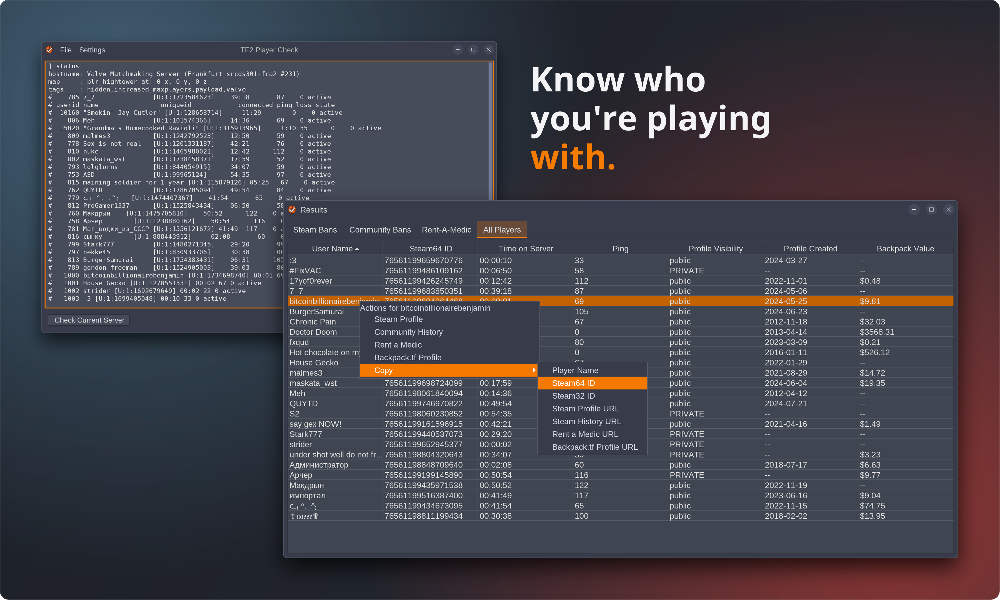

## Modern look and feel

TF2PlayerCheck uses Flatlaf, with over a dozen popular themes for you to choose to customize your UI.

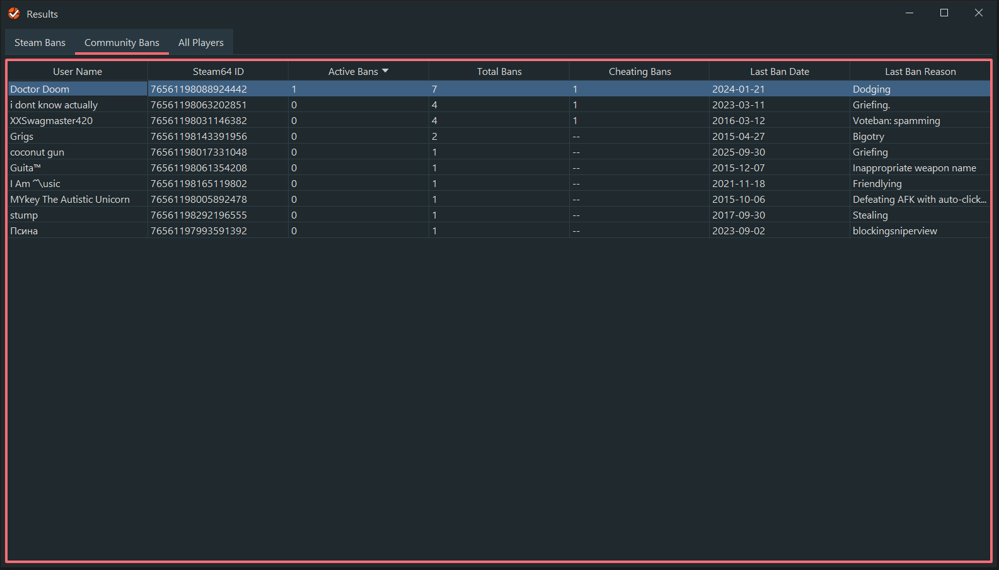

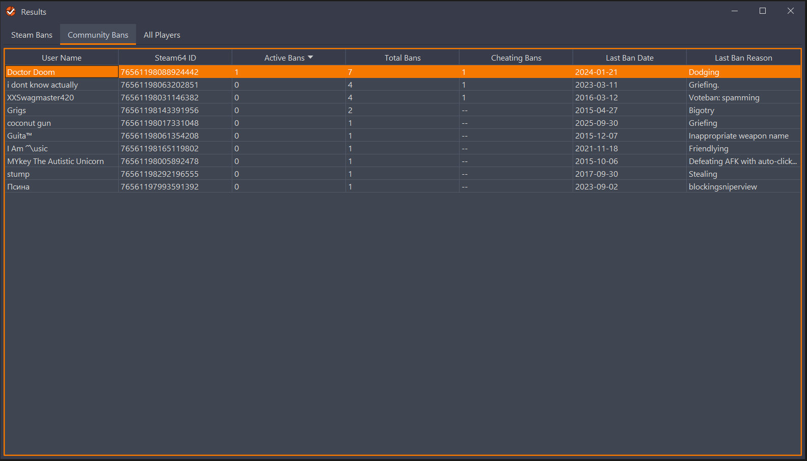

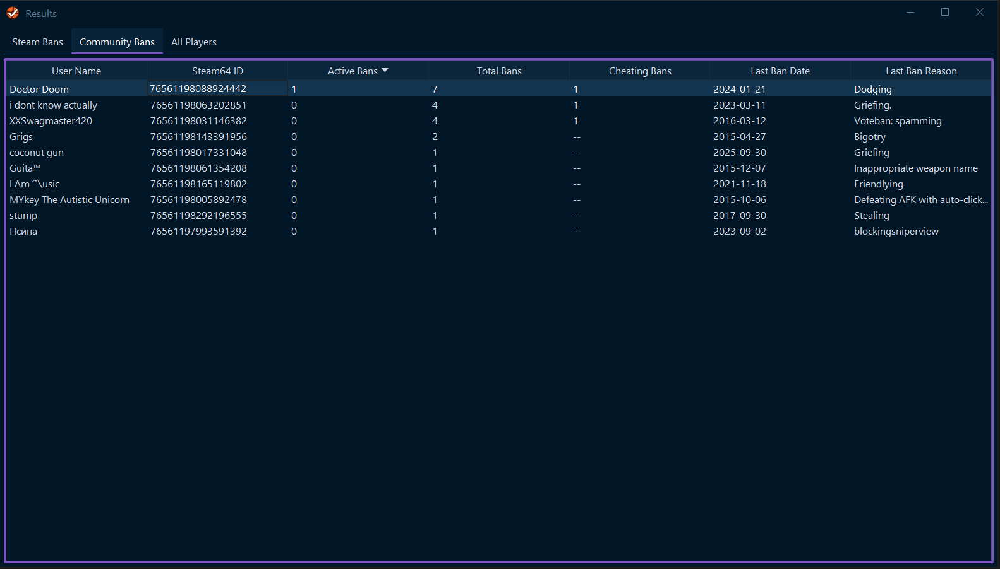

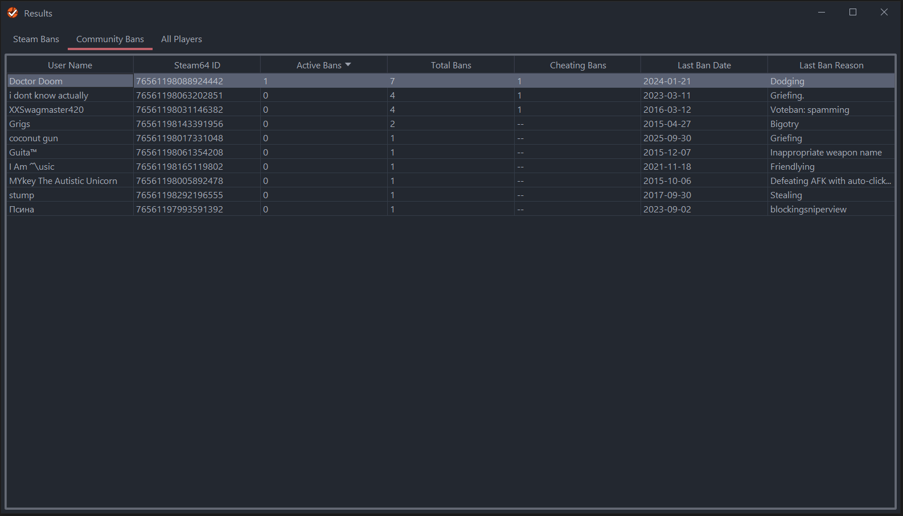

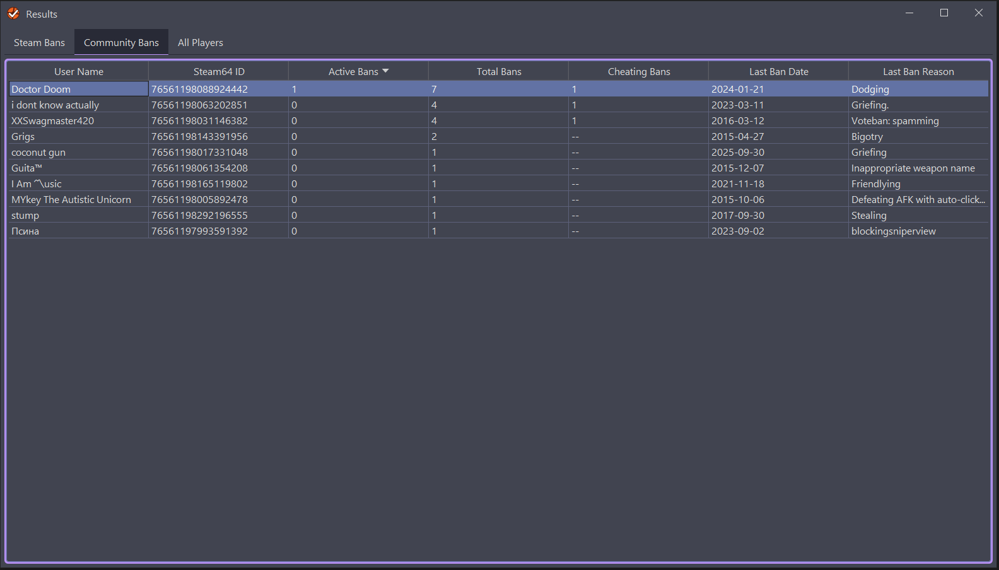

## Installation and Enabling TF2 Developer Console

On Windows you can download a Zip or MSI installer from the [releases page](https://github.com/fooberticus/TF2PlayerCheck/releases). Either install using the MSI, or unzip 
where you wish to install. Run the .exe and the program will start. These Windows distributions come with a Java Runtime Environment (JRE) included.

On Linux you can download the .jar from the releases page and run it with `java -jar <name of .jar file>`. Requires Java 25.

If you're a Java developer, you can clone this git project and run `mvn exec:java` in the project root. Requires Java 25 and Maven 3.

In your TF2 game, be sure the developer console is enabled. This is where you'll run the `status` command to get information
about who is playing on the server. When the status output is displayed, copy and paste it into the text field in the program.

For more information about enabling the developer console, see the [TF2 Wiki](https://wiki.teamfortress.com/wiki/Console).

## Setup: Configuring API Keys

The first time you run the program, you'll be presented with the API Key Configuration menu:

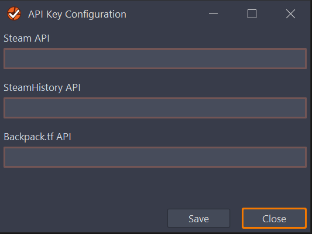

To use TF2PlayerCheck, you'll need API keys for the Steam API, SteamHistory.net API and Backpack.tf API.

You can get a Steam API key here:

https://steamcommunity.com/dev/apikey

For SteamHistory.net, you can login to the site with your Steam account and then get an API key here:

https://steamhistory.net/api

And for Backpack.tf, you can login to the site with your Steam account and then get an API key here 
(be sure to copy the API Key and not the Access Token):

https://next.backpack.tf/account/api-access

Once you've copied and pasted the API keys into the appropriate fields, you can save and then close the settings menu.
You're ready to use TF2 Player Check!

You can also adjust the appearance of the application using the Appearance Configuration window:

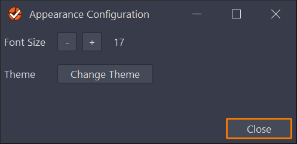

You can access both of these configuration windows at any time from the Settings menu in the main window:

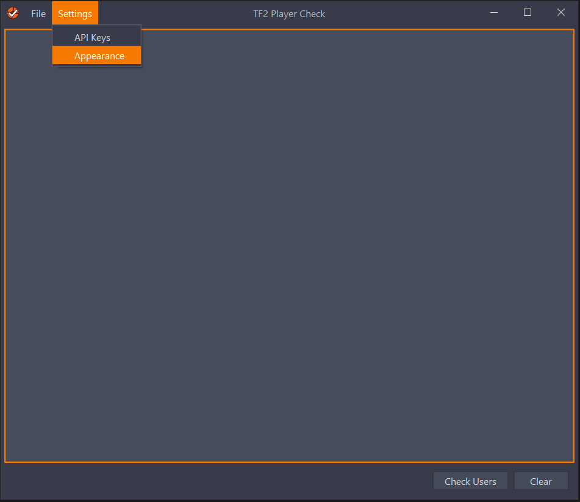

## Optional Setup: One-Click Server Check (RCON)

TF2 Player Check can read the player list straight from your running game.
Click **Check Current Server** and the results window opens, no console needed.

This uses RCON, a remote console feature built into TF2. It takes a one-time setup:

1. In TF2 Player Check, open **Settings → RCON Config**.
2. Enter a port and a password, then click **Save**.
   The default port, 27015, is fine unless another program on your PC already uses it.
   The password can't contain spaces, quotes (`"`) or semicolons (`;`).
3. Click **Copy Launcher Params**. This copies the TF2 launch options to your clipboard.
4. In Steam, right-click **Team Fortress 2** and choose **Properties**.
5. On the **General** tab, paste into **Launch Options**.
   If you already have launch options, add these after them, separated by a space.
6. Restart TF2 and join a server.
7. Click **Check Current Server** in TF2 Player Check.

The copied launch options look like this:

```
-usercon -g15 +ip 0.0.0.0 +sv_rcon_whitelist_address 127.0.0.1 +hostport 27015 +rcon_password yourpassword +net_start
```

| Option | What it does |
|---|---|
| `-usercon` | Turns on RCON in the TF2 game client. |
| `-g15` | Turns on the `g15_dumpplayer` command, which TF2 Player Check uses to read the player list. |
| `+ip 0.0.0.0 +hostport 27015 +net_start` | Starts the RCON listener on the port you chose. |
| `+rcon_password yourpassword` | Sets the password TF2 Player Check logs in with. |
| `+sv_rcon_whitelist_address 127.0.0.1` | Stops TF2 from banning TF2 Player Check's address after a failed password attempt. |

If you change the port or password later, click **Copy Launcher Params** again and replace the old launch options in Steam.

> [!WARNING]
> Because of `+ip 0.0.0.0`, TF2 accepts RCON connections from other computers on your network, so the password is the only protection.
> Anyone who knows it can run console commands in your game. Use a password you don't use anywhere else,
> and don't forward the RCON port on your router.

### RCON Troubleshooting

| Message | Fix |
|---|---|
| RCON Not Configured | Finish the setup steps above. |
| TF2 Needs -g15 | TF2 was started without `-g15`. Copy the launch options again from **Settings → RCON Config**, paste them into Steam, then restart TF2. |
| RCON Connection Failed | Make sure TF2 is running and was started with the launch options. Make sure the port and password in **Settings → RCON Config** match those launch options. |
| No Players Found | TF2 is connected, but you're not on a server yet. Join a server, then try again. |

## Usage

There are two ways to get the list of players on your server into TF2 Player Check. Both open the same Results window.

* **Option A: Copy and paste `status`.** Works right away, no extra setup.
* **Option B: One click with RCON.** Needs the one-time [RCON setup](#optional-setup-one-click-server-check-rcon), then no more copying and pasting.

### Option A: Copy and Paste the `status` Command

1. In Team Fortress 2, open the console and run the `status` command. Highlight the output text and copy it:

   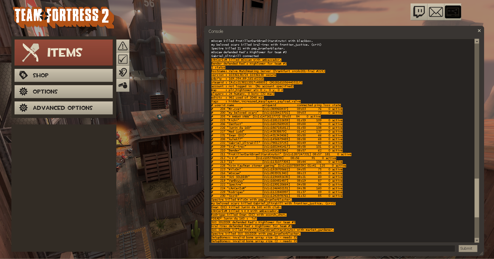

   You don't have to be precise, just make sure you copy whatever the `status` command prints out.

2. In the TF2 Player Check main window, paste the text into the text field. Either hit `Ctrl+V` or right-click to paste.

   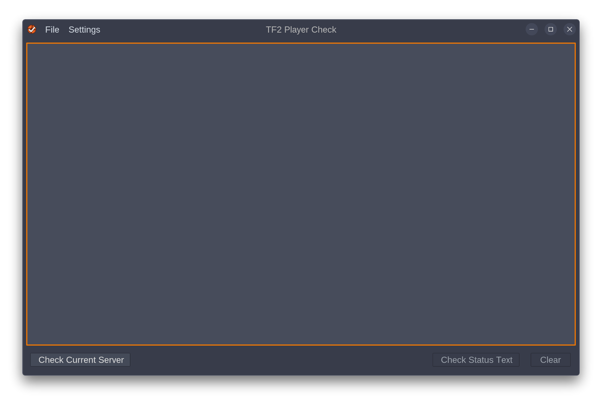

   Right-clicking clears the text field and pastes automatically, to make using the tool a little easier:

   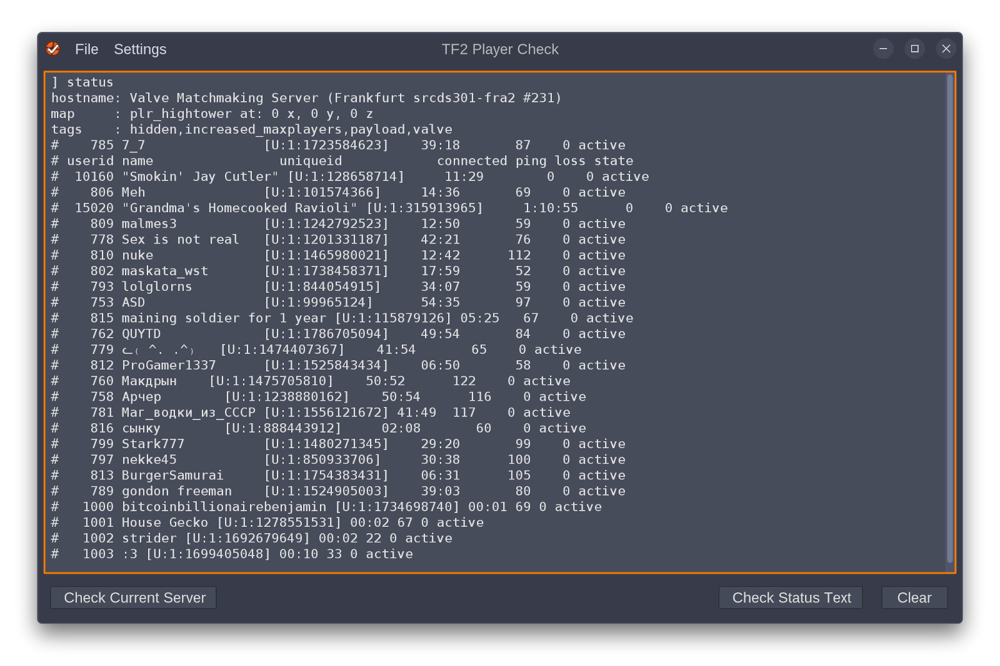

3. Click the **Check Status Text** button and wait for the Results window to open.
   The **Check Status Text** and **Clear** buttons stay greyed out until there is text in the text field.

### Option B: One-Click Check with RCON

1. Finish the [RCON setup](#optional-setup-one-click-server-check-rcon) once.
2. Start TF2 with the launch options from that setup, and join a server.
3. In the TF2 Player Check main window, click **Check Current Server**.

TF2 Player Check reads the player list straight from the game and opens the Results window.
You don't need to open the console or paste anything. If you get an error message, see [RCON Troubleshooting](#rcon-troubleshooting).

### Reading the Results

If any players have a VAC or Steam Game ban associated, the Steam Bans tab will appear with their name and
some info about the bans. You can double-click a row of player data to open their Steam profile:

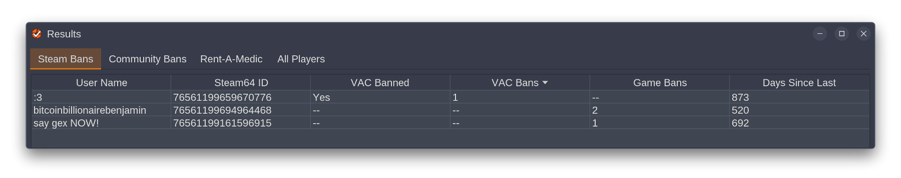

Likewise, if any players have community server bans, the Community Bans tab will be present with the player's name and ban summary.
You can double-click a row of player data to open their page on SteamHistory.net:

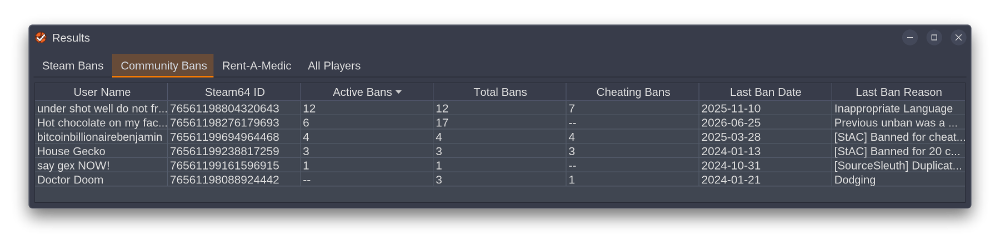

If any players are on the Rent-A-Medic cheater list, the Rent-A-Medic tab will be present. It shows whether they're an active cheater,
whether they're flagged as a human cheater or a bot, when they were added, and their ban counts.
You can double-click a row of player data to open their page on Rent-A-Medic:

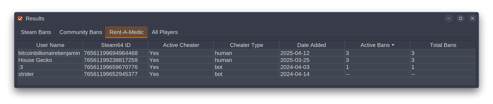

Finally, on the All Players tab you'll see a summary of all players on the server, whether they have a ban or not. 
This screen also shows general information about each player, like ping and time on server, as well as their Backpack.tf inventory value.

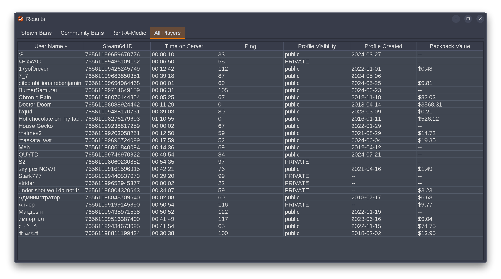

Right-click on any row in any screen to open a context menu where you can open a player's Steam Profile, SteamHistory.net profile, Backpack.tf inventory,
and more. You can also copy the player's name, Steam ID and any URLs to sources of information used by this app.

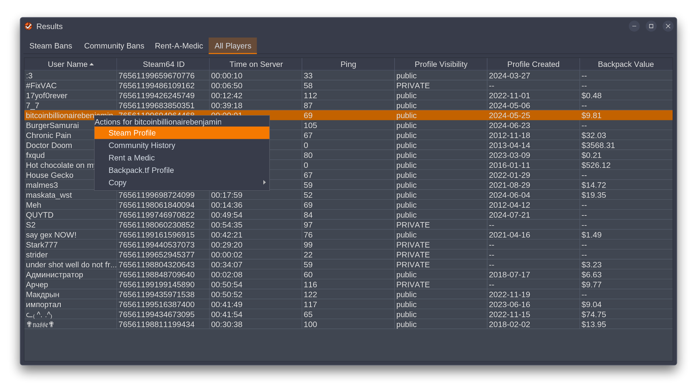

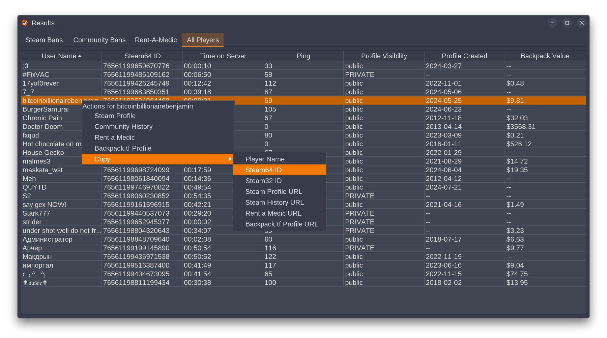

## Advanced Usage: Importing from Files, JSON and More

In addition to copying and pasting the output of `status`, you can also use any text containing Steam IDs. TF2PlayerCheck can parse Steam IDs from just about anything.

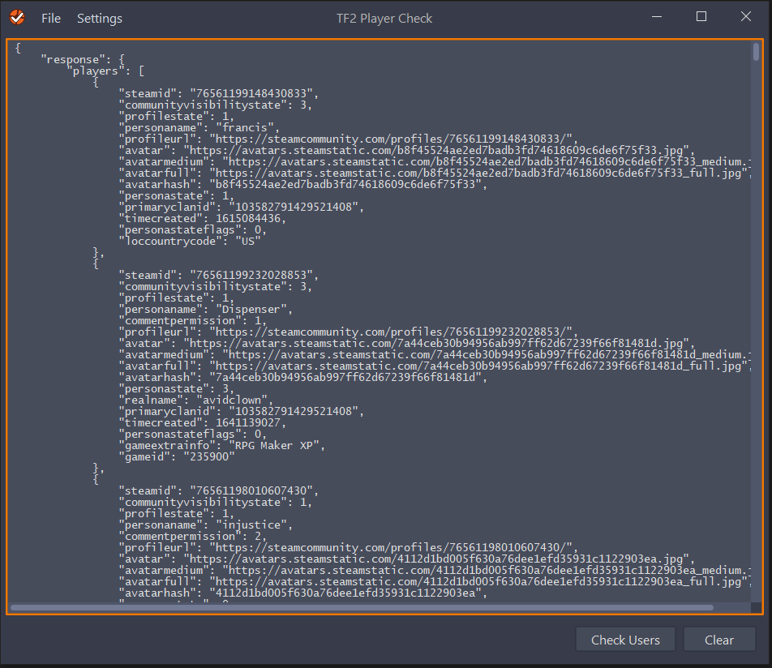

You can also import a file directly into the text input area using the File → Import menu option. 

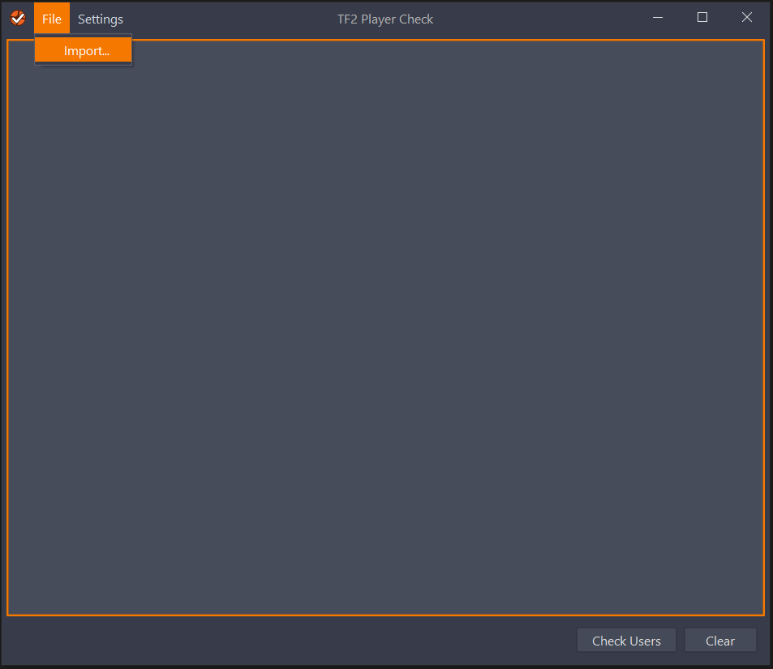

This is handy if you want to process a large console.log file, or you have a json file full of Steam IDs for instance.

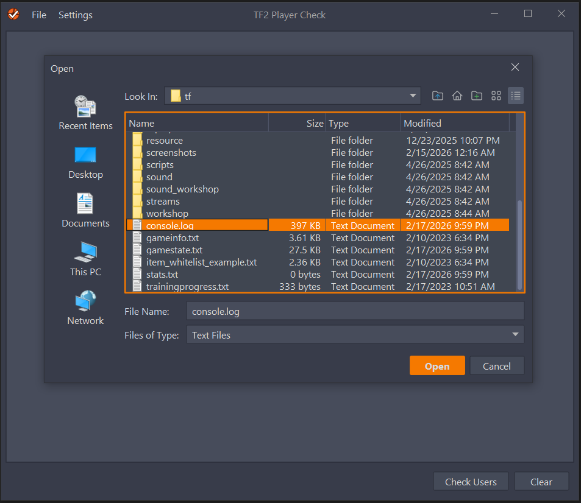

The various APIs TF2PlayerCheck uses have request size limits of 100 Steam IDs per request, but have no fear. 
Lists of Steam IDs larger than that will be processed in multiple smaller batches. So if you have a console.log file that you've been accumulating 
for a while that has thousands of IDs in it, go ahead and import it. Just be prepared to wait a bit while all the API calls are made.

## Build and Package the Project

If you're a Java developer, you can build the project with Maven:

`mvn clean package`

If you want to use `jpackage` to make an MSI and package up the JVM with a native executable, use the scripts found in the "jpackage"
folder in the root of the project. Just copy the *jar-with-dependencies.jar into the `jpackage\jars` folder, update the version
information in the files in the jpackage\opt folder, then run the batch script named `package-windows.bat` to create the MSI and Package with executable.

On Linux, run `package-linux.sh` instead to create a .deb installer and Package with executable. This needs a JDK that includes jmods,
plus `fakeroot` (on Ubuntu/Debian: `sudo apt install openjdk-25-jdk-headless fakeroot`).
